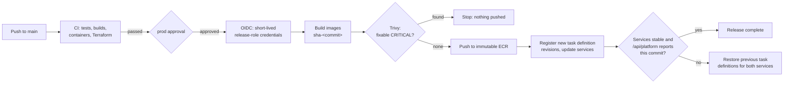
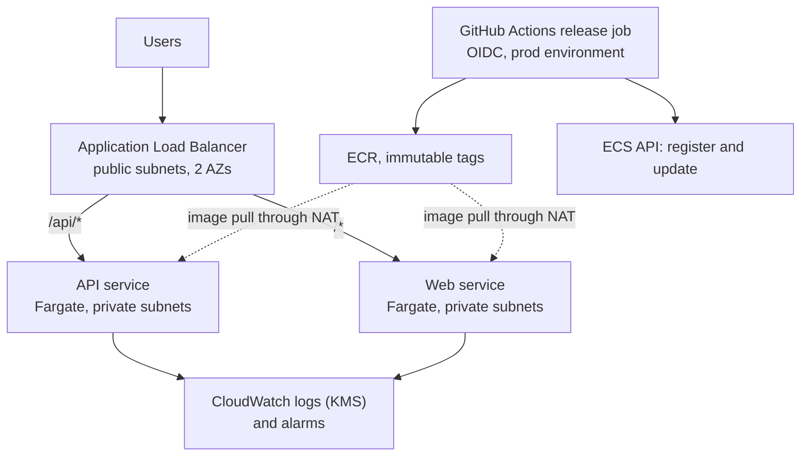

# ECS Release Platform

Traceable, self-verifying container releases on Amazon ECS Fargate. Every
running task maps to one Git commit, and a release that fails verification is
rolled back automatically.

**Status:** application, containers and infrastructure code are verified in CI.
The AWS foundation was deployed and verified on 2026-07-27, then torn down.
The first workload release, the automated release and the operational
exercises have not been run yet. See [evidence status](#evidence-status).

## The problem

Small teams that deploy containers by hand lose control of their releases:

- **No release identity.** Mutable tags such as `latest` mean nobody can say
  exactly which code is serving traffic.
- **Failures stay live.** A bad deploy keeps serving errors until a person
  notices it.
- **Improvised rollback.** Getting back to the last good version depends on
  memory and console clicks.
- **Exposed credentials.** CI systems hold long-lived cloud keys that can leak.

This platform closes those gaps for a two-service web application, and it can
be reused as a pattern for similar workloads.

## What the platform guarantees

Each guarantee is enforced by a specific control and proven by a specific
check. Status is reported conservatively: *implemented* means the code exists
and has not been exercised in AWS.

| Guarantee | Mechanism | How it is proven | Status |
|---|---|---|---|
| **Every running task traces to one commit** | Images are tagged `sha-<full commit>`; ECR repositories are `IMMUTABLE`, so a tag cannot be overwritten; the task definition injects `COMMIT_SHA`; the API reports it at `/api/platform` | The release passes only if the live API, reached through the ALB, reports the commit that was built | API contract verified locally; ECR immutability verified in AWS (2026-07-27); end-to-end pending Gate 4 |
| **A failed release does not stay live** | ECS deployment circuit breaker with `rollback = true`; the pipeline records both services' current task definitions and restores them if deployment, stabilization or the smoke test fails | A deliberately broken release that is rolled back ([exercise](docs/operations-runbook.md#controlled-failure-exercise)) | Implemented; Gate 6 pending |
| **No stored AWS credentials** | The release job exchanges a GitHub OIDC token for short-lived credentials on one IAM role. The trust policy accepts only this repository's `prod` environment. The role is scoped to two ECR repositories, two ECS services, and `iam:PassRole` for the ECS task and task execution roles, passed only to `ecs-tasks.amazonaws.com`. | Trust policy and role in [`infrastructure/github-release`](infrastructure/github-release); CloudTrail `AssumeRoleWithWebIdentity` in Gate 5 | Implemented; Gate 5 pending |
| **Only the load balancer is reachable** | Tasks run in private subnets without public IPs; task security groups accept traffic only from the ALB security group; outbound traffic leaves through NAT | Subnet and ingress checks; task network inspection | Subnets and ALB-only ingress verified (2026-07-27); task check pending Gate 4 |
| **Only verified, approved commits are released** | The release workflow runs only after CI succeeds for a push to `main`, and waits for the `prod` environment's required reviewer before credentials are issued | Run history of the Release workflow | Implemented; Gate 5 pending |
| **Images with fixable critical vulnerabilities do not ship** | Trivy runs before the push with `--severity CRITICAL --ignore-unfixed --exit-code 1`; ECR also scans on push | Pipeline log | ECR scan-on-push verified (2026-07-27); Trivy gate pending Gate 5 |
| **Releases cannot change infrastructure** | Terraform owns the network, cluster and baseline task definitions; the release role can only register task definition revisions and update the two services, and the workflow never runs `terraform apply` | The release role's policy grants no infrastructure permissions | Implemented |
| **Containers run with minimal privilege** | Non-root users (UID 10001 and 101); read-only root filesystem with a writable `/tmp` only | CI runs both containers read-only and checks the UIDs | Non-root verified locally (2026-07-27); read-only check in CI |
| **Losing a task does not take the application down** | Two Availability Zones; at least two tasks per service, scaling to four at 60% CPU; ALB health checks replace unhealthy targets | Stop a task and observe replacement; bounded load test | Implemented; Gate 6 pending |

The commit check reads the API. The web service's commit is carried by its
image tag and task definition but is not asserted at runtime.

## How a release works



Terraform bootstraps the first release; the
[release workflow](.github/workflows/release.yml) owns every release after that.
Its deploy, verify and rollback logic is
[`scripts/release-services.sh`](scripts/release-services.sh), which an operator
can also run by hand.

## Architecture



The application is deliberately small, because its job is to make release
identity observable:

| Endpoint | Purpose |
|---|---|
| `/health` | Web container and ALB target health |
| `/api/health` | API container and ALB target health |
| `/api/platform` | Service, environment, version, commit SHA and timestamp |

The [architecture record](docs/architecture.md) explains each boundary:
network, delivery, release, state and bootstrap, plus the
[release orchestration decision](docs/architecture.md#decision-release-orchestration-accepted-2026-11-21).

## Accepted trade-offs

These are deliberate lab choices, each with a defined upgrade path. Details are
in [explicit limitations](docs/architecture.md#explicit-limitations).

- One NAT gateway, so outbound traffic depends on a single AZ.
  `single_nat_gateway = false` adds one per AZ.
- Releases depend on GitHub Actions. If it is unavailable,
  `scripts/release-services.sh` can be run by hand.
- HTTP for the first verification. HTTPS requires an ACM certificate and a DNS
  record managed outside this stack.

## Evidence status

| Gate | Proves | Status |
|---|---|---|
| 1. Application | Type checks, tests, production builds | Verified locally and in CI |
| 2. Containers | Images build, health contracts, non-root runtime | Verified locally and in CI |
| 3. Foundation | Network, ECR, ALB, ECS cluster, IAM, state | Deployed and verified 2026-07-27; since torn down |
| 4. First release | Commit-tagged images running on Fargate behind the ALB | Not yet run |
| 5. Automated release | GitHub Actions builds, scans, deploys and verifies an approved commit | Not yet run |
| 6. Operations | Failed release rolled back, alarms, scaling | Not yet run |

Each checkbox in [deployment evidence](docs/deployment-evidence.md) is ticked
only after the output has been produced in the target AWS account.

## Run it

**Locally** (Node.js 22+, Docker with Compose):

```bash
npm run install:all && npm run validate
docker compose up --build
curl http://localhost:8080/api/platform
```

**On AWS:** follow the [deployment runbook](docs/deployment-runbook.md). The
ordered bootstrap is `scripts/bootstrap-platform.sh`, and the ordered teardown
is `scripts/teardown-platform.sh`. Both keep every `terraform apply` and
`terraform destroy` interactive.

The environment is billable while it exists: a NAT gateway, the ALB, four
Fargate tasks, ECR storage and CloudWatch logs.
Tear it down when you are not using it.

## Repository map

```text
apps/api/                      Express + TypeScript metadata API
apps/web/                      React + TypeScript release console
infrastructure/bootstrap-state Protected S3 state bucket
infrastructure/foundation      VPC, ALB, ECR, ECS cluster, IAM, KMS-encrypted logs
infrastructure/workload        Task definitions, services, autoscaling, alarms
infrastructure/github-release  GitHub OIDC provider and scoped release role
scripts/                       Bootstrap, build/push, deploy, rollback, smoke test, teardown
.github/workflows/             CI (ci.yml) and release (release.yml)
```

## Documentation

Each document owns one subject. The README links to them rather than repeating
them.

| Document | Owns |
|---|---|
| [Architecture](docs/architecture.md) | Boundaries, decisions and limitations |
| [Implementation workflow](docs/implementation-workflow.md) | Gate definitions and exit criteria |
| [Deployment runbook](docs/deployment-runbook.md) | First deployment and GitHub environment setup, step by step |
| [Operations runbook](docs/operations-runbook.md) | Health, rollback, exercises, teardown |
| [Deployment evidence](docs/deployment-evidence.md) | Dated proof for each gate |

Original source and Git history; not a fork. MIT License.
